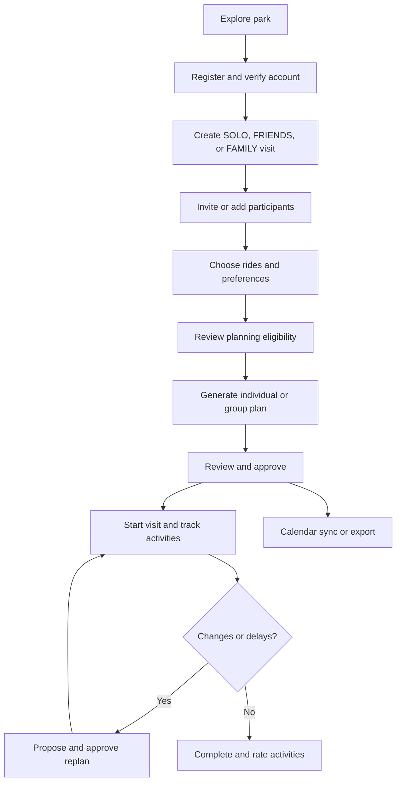
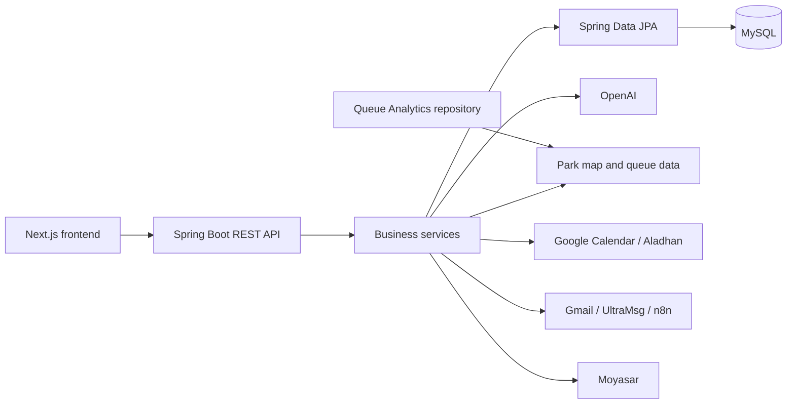

<div align="center">


# SIKKA | سكة 🎢

### Your Qiddiya day, planned in minutes.

**An AI-powered visit planner for Six Flags Qiddiya — for solo visitors, friends, and families.**

[](https://www.java.com/)
[](https://spring.io/projects/spring-boot)
[](https://www.mysql.com/)
[](https://github.com/Abdulaziz-Shafae/SIKKA-front)

[Overview](#overview) · [Features](#features) · [User Journey](#user-journey) · [Technology Stack](#technology-stack) · [Architecture](#architecture) · [API Overview](#api-overview) · [API Documentation](docs/API-DOCUMENTATION.md) · [Live Website](https://sikka.up.railway.app/#home) · [Project Repositories](#project-repositories)

</div>

---

## Overview

**SIKKA (سكة)** helps visitors plan and coordinate a day at **Six Flags Qiddiya City**. The platform brings together ride preferences, safety-related eligibility checks, group decisions, walking routes, queue information, meal and prayer breaks, and live visit progress.

An organizer creates a visit, members choose their preferences, and the backend combines park data with AI-assisted planning. Plans can be reviewed, approved, followed during the visit, and updated when circumstances change.

> **Scope:** SIKKA is a visit-planning service; it does **not** sell Six Flags admission tickets. Any SIKKA payment refers to its planning features.

## The Problem & Our Solution

| Challenge | SIKKA's approach |
|---|---|
| Different ride preferences and restrictions | Visitor profiles, ride priorities, exclusions, and server-side eligibility checks |
| Coordinating groups and families | SOLO, FRIENDS, and FAMILY visits, invitations, RSVP, and shared decisions |
| Managing waiting and walking time | Queue information and estimated walking routes included in the itinerary |
| Making time for meals and prayer | Meal and snack preferences and prayer-time scheduling |
| Responding to delays | Visit progress, notifications, and proposed replanning |
| Remembering the experience | Completed activities, ratings, and visit summaries |

## Features

### Planning & Coordination

- Create **SOLO**, **FRIENDS**, and **FAMILY** visits.
- Invite members with a code, QR code, or shareable link.
- Collect RSVP responses and ride preferences with `MUST_RIDE`, `PREFERRED`, and `OPTIONAL` priorities.
- Generate AI-assisted individual and coordinated group plans, while applying backend-side constraints and validations.
- Review, approve, and propose adjustments to plans.

### Park Experience

- Explore the park's ride and place catalogue and map.
- Use ride restrictions, available queue data, and walking-distance estimates when planning.
- Include meals, snacks, and optional prayer-time breaks.
- Track activities, record completion, and view visit progress.
- Receive in-app alerts and, where configured, external notifications.
- Sync approved plans with Google Calendar or export an Apple-compatible `.ics` file.

### Account & Payments

- Account registration, email verification, optional phone verification, and password recovery.
- Session-based authentication, access controls, and account-specific visit permissions.
- Free-visit allowances and server-verified Moyasar payments for paid planning.

## User Journey



## Technology Stack

| Layer | Technologies |
|---|---|
| Backend | Java 17, Spring Boot 4.1.1, REST API |
| Database | MySQL, Spring Data JPA, Hibernate |
| Security | Spring Security, BCrypt, session authentication |
| Frontend (separate repository) | Next.js 16, React 19, TypeScript, Tailwind CSS, shadcn/ui |
| AI | OpenAI API with backend itinerary validation |
| Maps & park data | Park map, walkable route data, ride and place catalogue |
| Notifications | In-app events, n8n webhooks, UltraMsg WhatsApp, Gmail SMTP |
| Payments | Moyasar API |
| Calendar | Google Calendar OAuth and Apple-compatible `.ics` export |
| Other | Aladhan prayer-time API, ZXing QR generation |
| Development & delivery | Maven, JUnit, Mockito, Docker, GitHub Actions, Railway |

## External APIs & Integrations

| Service | Purpose |
|---|---|
| OpenAI | AI-assisted itinerary generation and replanning |
| Aladhan | Prayer times used in scheduling |
| Google Calendar | Account connection and plan event synchronization |
| Gmail SMTP | Account email verification and notifications |
| UltraMsg WhatsApp | Phone verification and messages |
| Moyasar | Server-side payment verification |
| n8n | Notification automation webhooks |
| Queue Analytics | Separate data collection and analysis service for wait-time insights |

> Availability of external integrations depends on runtime configuration and valid credentials. Park wait times and walking estimates should not be represented as guaranteed real-time values.

## Architecture



The backend follows a conventional layered structure:

```text
src/main/java/com/example/sikka/
├── Advice/       # Global exception handling
├── Api/          # Common API responses and exceptions
├── Config/       # Security and configuration
├── Controller/   # HTTP routes
├── DtoIn/        # Request objects
├── DtoOut/       # Response objects
├── Model/        # JPA entities
├── Repository/   # Database access
└── Service/      # Application logic and integrations
```

## API Overview

The reviewed backend contains **22 controllers** and approximately **170 declared HTTP endpoints**. Route totals reflect the reviewed code snapshot and may change as the repository evolves.

| API area | Examples |
|---|---|
| Accounts & authentication | Registration, login-related account data, verification, password recovery |
| Visits & participants | Create visits, invitations, RSVP, family members, ride preferences |
| AI planning | Generate and review plans, approval, replan requests, plan history |
| Park data | Rides, places, map, routes, ride eligibility |
| Live visit | Activity sessions, completion records, progress, food breaks |
| Integrations | Calendar, payment confirmation, notifications, privacy consent |

**Full endpoint reference:** [API Documentation](docs/API-DOCUMENTATION.md).

## Data Model

The backend includes **22 JPA model classes** across accounts, visits, planning, park data, messaging, payments, and calendar synchronization.

| Area | Main models |
|---|---|
| Accounts & participation | `Account`, `VisitorProfile`, `FamilyMember`, `Visit`, `VisitGroup`, `VisitMember` |
| Planning | `VisitPlan`, `PlanItem`, `PlanApproval`, `PlanHistory`, `VisitMealBreak` |
| Live activity | `VisitRecord`, `ActivitySession`, `Notification` |
| Park & payment | `Ride`, `Place`, `RidePreference`, `PaymentOrder`, `PrivacyConsent` |
| Calendar | `GoogleCalendarConnection`, `GoogleCalendarEvent`, `GoogleCalendarOAuthState` |

## Project Repositories

| Resource | Link |
|---|---|
| Live website | [SIKKA on Railway](https://sikka.up.railway.app/#home) |
| Backend (this repository) | [Abdulaziz-Shafae/Sikka](https://github.com/Abdulaziz-Shafae/Sikka) |
| Final project snapshot | [Abdulaziz-Shafae/SIKKA-final](https://github.com/Abdulaziz-Shafae/SIKKA-final) |
| Frontend | [Abdulaziz-Shafae/SIKKA-front](https://github.com/Abdulaziz-Shafae/SIKKA-front) |
| Queue analysis & data collection | [Abdulaziz-Shafae/Queue_Analytics](https://github.com/Abdulaziz-Shafae/Queue_Analytics) |
| Source queue data | [Queue-Times park 335 JSON](https://queue-times.com/parks/335/queue_times.json) |
| Backend API reference | [docs/API-DOCUMENTATION.md](docs/API-DOCUMENTATION.md) |

## Abdulaziz Shafae Contributions

**Core entities:** VisitPlan, PlanItem, PlanApproval, PlanHistory, VisitRecord, ActivitySession, Notification, GoogleCalendarConnection, GoogleCalendarEvent, GoogleCalendarOAuthState.

**Main work:** AI-driven individual/group planning, ride priorities and scheduling constraints, plan approval, replanning, subgroup coordination, live activity tracking, GPS-assisted actions, completion records, ratings, summaries and progress.

**AI:** OpenAI-assisted generation and replanning, with backend validation of available rides, time budgets, exclusions, queue estimates and prayer scheduling.

**Integrations:** Google Calendar OAuth/synchronization and Apple `.ics` exports; map-route and prayer-time data consumed during scheduling.

**Notification work:** in-app notifications, read state, delay checks and responses. n8n delivery services were introduced by Nawaf, so this integration is shared work rather than solely credited here.

**Frontend & queue analytics projects:**

- **[SIKKA Frontend](https://github.com/Abdulaziz-Shafae/SIKKA-front):** Next.js, React and TypeScript web application integrating the park experience with backend services.
- **[Queue Analytics & Data Collection](https://github.com/Abdulaziz-Shafae/Queue_Analytics):** Separate repository for collecting and analyzing ride-queue data used by the planning ecosystem.

**Additional contributions:** shared visit/member endpoint implementation, cross-module integration, merge resolution, and backend regression and integration testing.

## Team

SIKKA was developed collaboratively by **Abdulaziz Shafae**, **Mohammed Aljubaili**, and **Nawaf Alghamdi**. Work spans account and visit management, AI planning and tracking, park data and routing, integrations, frontend delivery, and quality assurance.

---

<div align="center">

**SIKKA | سكة** · Your Qiddiya day, planned in minutes. 🎢

</div>
